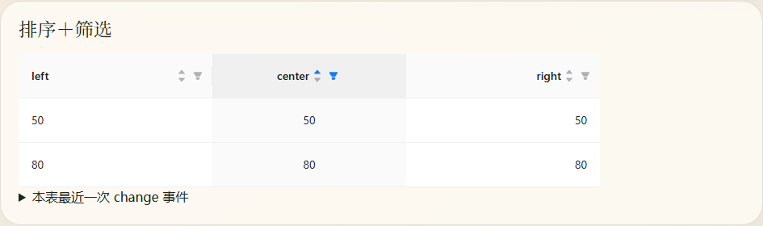
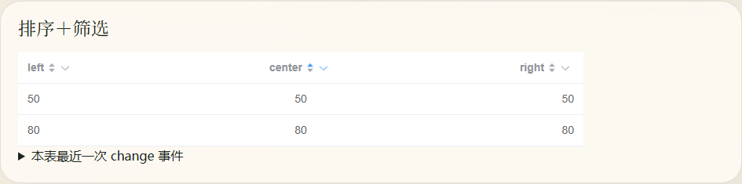

# 表头内容整体对齐验证

关联：[#59](https://github.com/parade0393/vtable-guild/issues/59)。

## 行为

- Element Plus：普通表头、排序、筛选和排序＋筛选均按 `column.align` 对齐，标题与控件保持相邻。
- Antdv：`align: 'center'` 将标题、排序图标与筛选按钮作为整体居中；left/right 保留原布局。这是视觉优化，不以原生 Antdv 的标题占满剩余空间为目标。
- 两套预设：长标题省略时保留排序、筛选控件的宽度；正文开启省略提示后仍保持 center/right 对齐。
- 排序 Tooltip 开关、列级与插槽筛选图标、分组表头及虚拟表体均覆盖。

`data-align` 由列配置传到各布局层，视觉规则仍由 theme slots 控制。需要通过 `ui` 定制居中布局时，应使用相同的属性变体，例如 `headerCellInner: '[&[data-align=center]]:justify-start'`。只修改 th 的 `text-align` 不会改变内容组的位置。

## 复现入口

运行 `pnpm playground`，打开 `/#/header-alignment`，切换顶部两套预设。页面支持 prebuilt/Tailwind 4、排序提示、长标题、省略开关，包含 8 张独立表格。

1. 观察普通、仅排序、仅筛选和排序＋筛选的 center 列，整个内容组应有相等的左右留白。
2. 点击排序列，数据依次为 20、50、80；点击筛选按钮不应改变排序。
3. 筛选“大于等于 50”，结果为 50、80；再次排序可变为 80、50。
4. 开启长标题、关闭排序提示，标题省略且按钮仍可点击。
5. 检查 Element Plus 的 left/right、两预设的正文对齐，以及自定义筛选图标、分组和虚拟表格。

## 验证结果

独立浏览器页面直接消费本地聚合包构建产物，未使用 demo 的补丁样式。prebuilt、Tailwind 3（使用公开 preset 独立生成 CSS）、Tailwind 4 共 240 个表头布局检查通过；包括 Tooltip 开关、长标题、帮助图标、默认及两种自定义筛选图标、分组和虚拟表体。

Playground 的 240px 列宽下，排序＋筛选内容组实测：

| 预设         | 左侧留白 | 右侧留白 |
| ------------ | -------: | -------: |
| Antdv        |  80.09px |  80.11px |
| Element Plus |  79.98px |  79.98px |

Playground 的 prebuilt/Tailwind 4 均完成真实排序、筛选与长标题交互；新增 14 项回归测试覆盖交互隔离、动态对齐与分组列。仓库检查使用 `pnpm lint`、`pnpm type-check`、`pnpm build`、`pnpm test`。

