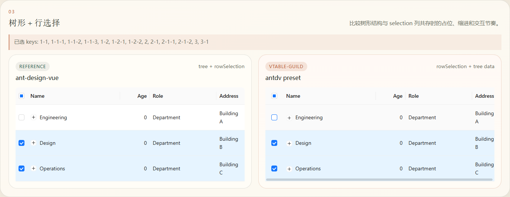
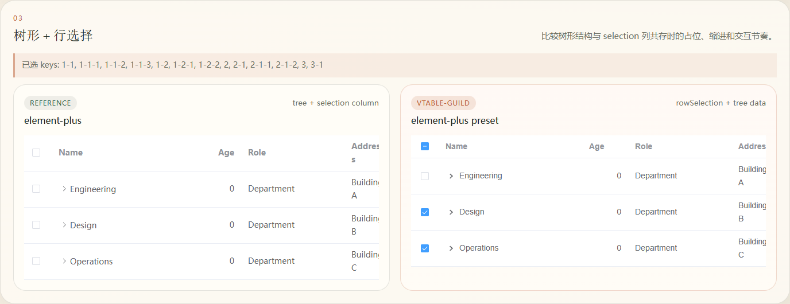

# 树形选择回归记录

验证页面：启动 `pnpm playground` 后打开 `http://127.0.0.1:5173/#/tree`，使用第 03 组「树形 + 行选择」右侧的 VTable。

1. 保持树节点折叠，点击表头全选，确认已选 keys 包含全部 14 个节点。
2. 取消 Engineering 节点，确认只移除 key `1`，其折叠子节点仍选中；表头显示半选。
3. 切换 `antdv` 和 `element-plus` 预设，重复验证。

两套预设均通过。下图记录第 2 步，页面的已选 keys 展示保留的 13 个节点。

同时验证了 CSS 重建：运行复制脚本时持续读取两份输出中的 18 个 CSS 文件，分别检查内容不变、切换类名前缀和恢复默认前缀的情况，均未出现缺失、空文件或中间内容。重建后 Playground 样式请求返回 200，页面正常加载。
